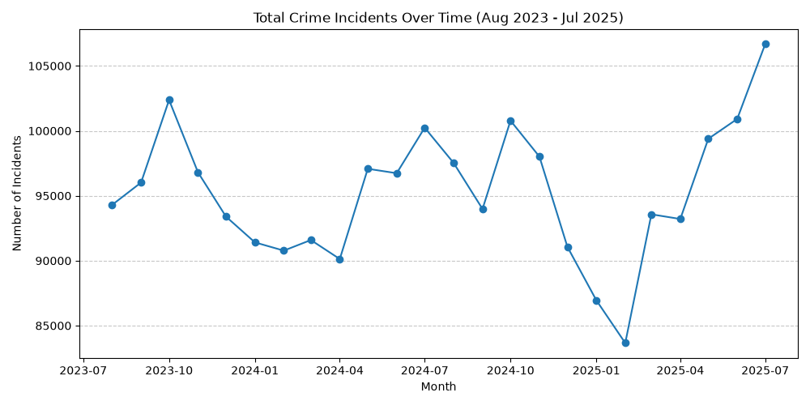
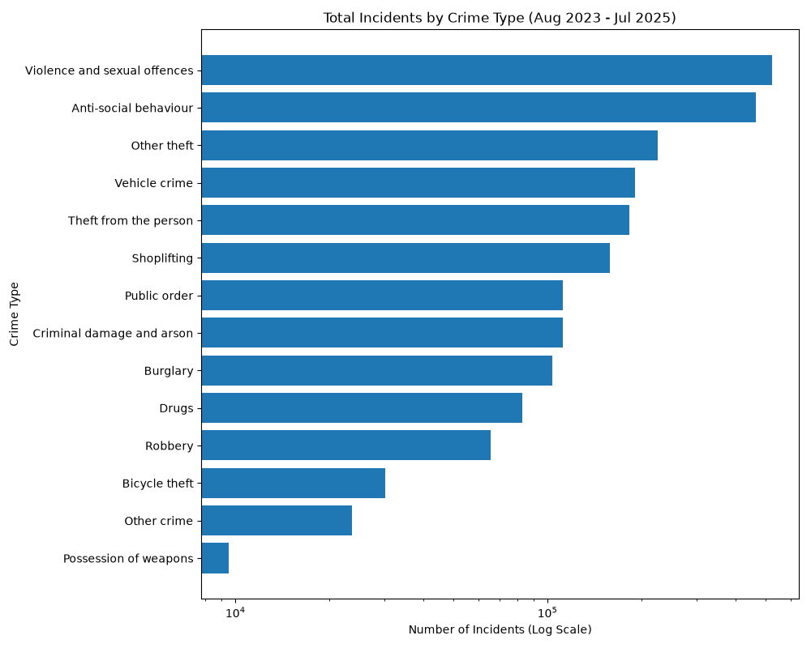

# CrimeScope — Crime Data Analysis & Knowledge Representation

Statistical analysis of 24 months of UK Metropolitan Police street-level crime
data (August 2023 – July 2025). Aggregates **2,286,594 records** across monthly
CSV archives to examine temporal trends, category distributions, and fits a
normal distribution to monthly crime counts.

---

## 📊 Output

**Monthly crime counts, August 2023 – July 2025**



**Distribution by crime category**



---

## 🧰 Tech stack

| | Role |
| :--- | :--- |
| **pandas** | Reads and concatenates 24 monthly CSVs into a single frame |
| **NumPy** | Numeric work underneath the aggregation |
| **SciPy** (`stats.norm`) | Fits a normal distribution to monthly counts |
| **matplotlib** | Renders the two charts above |
| **zipfile** (stdlib) | Locates and extracts the source archive |

No database and no notebook — it is a single script that goes from a zip file
to two charts, so it can be run end to end in one command.

---

## 🌟 What it does

* 📦 **Archive handling** — locates the monthly `.zip`, extracts it, and walks
  the `YYYY-MM/` directory structure automatically.
* 🧹 **Aggregation** — concatenates 24 monthly CSVs into a single DataFrame,
  keeping only the required columns and handling missing coordinates and
  unclassified categories.
* 📈 **Temporal trends** — monthly crime counts plotted as a time series
  (`q1c_graph1_time.png`).
* 📊 **Category breakdown** — frequency distribution across crime types such as
  anti-social behaviour, burglary and violent crime
  (`q1c_graph2_crime_types.png`).
* 📍 **LSOA-level queries** — identifies the Lower Layer Super Output Area with
  the highest anti-social behaviour, and the highest bicycle theft in a given
  month.
* 📐 **Statistical modelling** — fits `scipy.stats.norm` to monthly counts to
  produce a probability density function.

---

## 📦 Getting the data

**The CSVs are not in this repository** — they total around 500 MB, and GitHub
rejects files over 100 MB.

1. Go to <https://data.police.uk/data/>
2. Select **Metropolitan Police Service**
3. Set the date range to **August 2023 – July 2025**
4. Tick **Include crime data**, then download
5. Place the resulting `.zip` in this folder

The script finds any `.zip` in the project directory, extracts it, and reads
every `YYYY-MM/*-metropolitan-street.csv` inside. If you already have the
extracted month folders, it will use those directly.

---

## 📁 Structure

```text
CrimeScope/
├── Crime Data Analysis & Knowledge Representation.py   # Full analysis
├── 20XX-XX/                                            # Monthly CSVs (gitignored)
├── *.zip                                               # Source archive (gitignored)
├── q1c_graph1_time.png                                 # Output: temporal trend
├── q1c_graph2_crime_types.png                          # Output: category counts
├── requirements.txt
└── readme.md
```

---

## 🔧 Setup

```bash
cd CrimeScope
pip install -r requirements.txt
python "Crime Data Analysis & Knowledge Representation.py"
```

**Dependencies:** pandas, numpy, matplotlib, scipy.

Expect the first run to take a few minutes and roughly 1–2 GB of RAM — all 24
months are held in memory at once before concatenation.

---

## ▶️ Usage

There is nothing interactive — run the script and it works through the whole
analysis in order, printing results and writing the charts to disk. It is
organised as three sections that run in sequence:

| Section | What it prints |
| :--- | :--- |
| **Q1a** — load & clean | Files found, months loaded, total row count |
| **Q1b** — categories & LSOAs | Every crime type present; the LSOA with the most anti-social behaviour; the LSOA with the most bicycle theft in June 2024 |
| **Q1c** — trends & modelling | Writes both charts, then prints an interpretation of each |

To analyse a different force or date range, download that data from
[data.police.uk](https://data.police.uk/data/) and drop the zip in this folder
— the script does not hardcode the force. It **does** hardcode June 2024 for
the bicycle-theft query, so that one returns nothing on a different range; see
the limitations below.

---

## 🧠 Engineering decisions

**Concatenate first, then analyse.** Every query runs against the full 2.3M-row
frame rather than being computed per month and combined. That costs memory but
keeps each answer to a single, readable groupby. At this size the trade is
worth it; at ten years of data it would not be, and the fix is noted below.

**Only the required columns are kept.** The source CSVs carry a dozen fields;
loading all of them across 24 months was the difference between comfortable and
swapping.

**SciPy's fitted normal is presented as a model, not a finding.** The PDF is
plotted over the observed counts so the two can be compared by eye. The README
says plainly that normality was assumed rather than tested — that limitation is
part of the result, not a footnote to hide.

---

## ⚠️ Known limitations

- **Loads everything into memory.** All 24 months are read into a list of
  DataFrames and concatenated in one go. Processing month by month, or using
  chunked reads, would scale far better and is the obvious improvement.
- **Counts are not population-adjusted.** An LSOA with more reported crime may
  simply have more people in it. Per-capita rates would need ONS population data.
- **Normality is assumed, not tested.** A normal distribution is fitted to
  monthly counts without a Shapiro-Wilk or similar check that the data is
  actually normal.
- **Reported crime ≠ actual crime.** These figures reflect what was reported to
  and recorded by police, which under-represents some categories substantially.
- **Fixed date assumptions.** Some queries hardcode specific months (e.g. June
  2024) and will return empty results on a different date range.

---

## 📄 Data licence

Contains public sector information licensed under the
[Open Government Licence v3.0](https://www.nationalarchives.gov.uk/doc/open-government-licence/version/3/).

---

## 👨‍💻 Author

**Manan Arora**
